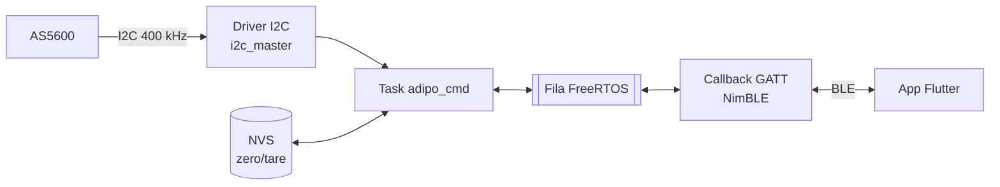

# Adipômetro digital BLE (ESP32-C3 + AS5600)

> Protótipo educacional. **Não é um dispositivo médico** e não deve ser usado para diagnóstico.

## Objetivo

Medir a espessura de dobras cutâneas com uma pinça instrumentada: um sensor magnético de ângulo (AS5600) lê a abertura do braço, o ESP32-C3 converte o ângulo em milímetros e envia o resultado por Bluetooth Low Energy para um app Android em Flutter.

## Destaques técnicos

- Driver do AS5600 escrito sobre a nova API `i2c_master` do ESP-IDF v5.x (bus + device handles).
- Servidor GATT próprio sobre NimBLE (service + 2 characteristics, advertising, notify).
- Callback GATT curto: só copia o comando para uma fila FreeRTOS; a task `adipo_cmd` faz o trabalho pesado (parse, leitura I2C, resposta).
- Zero mecânico (tare) persistido em NVS e recarregado no boot.
- Protocolo JSON simples (`medir`, `tare`, `status`, `ping`) via cJSON.
- App Flutter (Android) com `flutter_blue_plus`: conexão única, calibração guiada e medição por dobra.
- Matemática de conversão isolada em `caliper_math` e testada em host (CMake + CTest); testes unitários Dart no app; CI no GitHub Actions.

## Hardware

| Componente | Ligação |
|---|---|
| ESP32-C3 (DevKit) | MCU, BLE 5 |
| AS5600 (sensor magnético de ângulo) | I2C: SDA → GPIO8, SCL → GPIO9, endereço `0x36`, 400 kHz |
| Ímã diametral | No eixo de rotação da pinça, centrado sobre o AS5600 |
| Pull-ups 4,7 kΩ | SDA/SCL → 3V3 (recomendado; o driver também habilita pull-up interno) |
| Pinça (braço de 120 mm) | Pontas de medição a 120 mm do eixo |

## Arquitetura



Fluxo: o app escreve um JSON em `Command` → o callback GATT copia para a fila → `adipo_cmd` faz o parse, lê o sensor e responde por notify em `Measurement` (a última resposta também fica disponível por `READ`).

## GATT

Nome anunciado: `Adipometro-C3`.

| Função | UUID | Propriedades |
|---|---|---|
| Service | `7a4f0001-2b21-4f37-a602-b29e00000001` | Primary service |
| Measurement | `7a4f0002-2b21-4f37-a602-b29e00000001` | `READ / NOTIFY` |
| Command | `7a4f0003-2b21-4f37-a602-b29e00000001` | `READ / WRITE / WRITE_NO_RSP` |

## Protocolo

| Comando (app → `Command`) | Resposta (notify em `Measurement`) |
|---|---|
| `{"cmd":"medir","dobra":"tricipital"}` | `{"ok":true,"dobra":"tricipital","mm":12.34}` |
| (alerta magnético) | `{"ok":true,"dobra":"peitoral","mm":7.91,"warn":"ima_fraco"}` |
| (erro) | `{"ok":false,"erro":"ima_nao_detectado","dobra":"tricipital"}` |
| `{"cmd":"tare"}` | `{"ok":true,"cmd":"tare","zero_calibrated":true,"zero_saved":true,"zero_angle_deg":83.15}` |
| `{"cmd":"status"}` | `{"ok":true,"cmd":"status","magnet":true,"weak":false,"strong":false,"zero_calibrated":true,"zero_angle_deg":83.15,"raw":1024,"angle_deg":90}` |
| `{"cmd":"ping"}` | `{"ok":true,"cmd":"pong","uptime_ms":123456}` |

Detalhes em [`firmware/README.md`](firmware/README.md).

## Modelo de medição

Modelo de corda: as duas pontas estão a `L = 120 mm` do eixo, e a abertura é a distância entre elas.

```text
Δ          = ângulo_atual − ângulo_zero
abertura   = 2 · L · sin(Δ / 2) + offset      (L = 120 mm)
abertura   ∈ [0, 80] mm  (saturada)
```

Parâmetros em `firmware/main/main.cpp` (`ADIPO_ARM_LENGTH_MM`, `ADIPO_MM_OFFSET`, `ADIPO_INVERT_ANGLE_DIRECTION`, `ADIPO_MM_MIN/MAX`).

Calibração:

1. Feche completamente a pinça e envie `{"cmd":"tare"}` (o app expõe isso como calibração guiada). O zero vai para a NVS.
2. Abra a pinça numa referência conhecida (bloco-padrão ou paquímetro) e envie `{"cmd":"medir","dobra":"teste"}`.
3. Compare `mm` com a abertura real; ajuste `ADIPO_MM_OFFSET` ou, se a leitura diminuir ao abrir, inverta `ADIPO_INVERT_ANGLE_DIRECTION`.
4. Repita o tare só se o ímã/sensor for reposicionado ou houver alteração mecânica.

## Estrutura do repositório

```text
.
├── firmware/                    # ESP-IDF v5.5.x (C++)
│   ├── main/
│   │   ├── main.cpp             # fila, task adipo_cmd, protocolo JSON, NVS
│   │   ├── caliper_math.{h,cpp} # conversão ângulo → mm (pura, testável)
│   │   └── driver/AS5600.{h,cpp}
│   ├── components/ble_adipometer/  # servidor GATT NimBLE
│   └── test/host/               # testes em host (CMake + CTest)
├── app/                         # app Flutter (Android)
│   ├── lib/{models,screens,services}/
│   └── test/
└── .github/workflows/ci.yml
```

## Como compilar e gravar

Firmware (ESP-IDF v5.5.x, terminal do ESP-IDF):

```bash
cd firmware
idf.py set-target esp32c3
idf.py build flash monitor
```

App (Flutter stable, Android com BLE):

```bash
cd app
flutter pub get
flutter run
```

## Testes

Matemática do firmware, em host (sem ESP-IDF):

```bash
cmake -S firmware/test/host -B build-host
cmake --build build-host
ctest --test-dir build-host -C Debug --output-on-failure
```

App:

```bash
cd app && flutter test
```

O CI (`.github/workflows/ci.yml`) roda build do firmware, testes em host e `flutter analyze` + `flutter test` a cada push/PR.

## Resultados

Exatidão — *a preencher após ensaio*:

| Abertura real (paquímetro) [mm] | Medida [mm] | Erro [mm] |
|---|---|---|
| | | |

- Latência comando → notify: *a medir*
- Consumo (advertising / conectado / medindo): *a medir*

## Limitações e próximos passos

- Baixo consumo: light sleep / modem sleep entre medições.
- Calibração em dois pontos (ganho + offset) em vez de só zero.
- Medição de bateria e envio no `status`.
- Atualização OTA do firmware.

## Licença

[MIT](LICENSE). Dependências mantêm suas próprias licenças: ESP-IDF, NimBLE e cJSON (Apache-2.0/MIT, via ESP-IDF); no app, `flutter_blue_plus` tem licença própria (uso não comercial declarado no código com `License.nonprofit`) e `permission_handler` (MIT).
